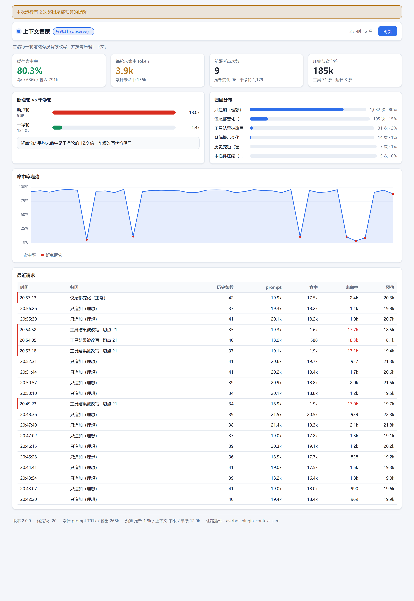

# astrbot_plugin_context_launcher · Context Launcher

> **One line: turn "why did this turn miss the prefix cache?" from a guess into attribution and numbers — then let you decide whether to compress.**
> Observe-only by default; not a single byte is changed. No LLM tools registered. No other plugin's hooks are hijacked.

Version 2.0.0 · AstrBot `>=4.16,<5` · No third-party dependencies · MIT

---

## Why you want it

Prefix caching is simple in principle — identical prefix, much cheaper prompt — but it fails in unglamorous ways.
Every turn is a fresh payload, and any tiny change re-bills everything after the change point: the window slides and
the whole history shifts right; a tool result gets compressed mid-history; a plugin injects one date line near the top.
Only the first of these is visible in config. The others need a look at the **fully assembled payload per request**.

This plugin is that observation point: `on_llm_request(priority=-20)` — a negative priority runs last, so it sees the
final request after every other plugin has injected. It only reads, never writes.



> The view follows the WebUI language setting. The screenshot uses sample data (Chinese locale), not a real conversation.

## What it does

### 1. Observation (default, zero rewriting)

- Per-message fingerprints for `system_prompt`, tool definitions and every history message, compared with the same
  session's previous turn and attributed to `append` / `tail` / `system` / `tools` / `history` / `history_tool` /
  `history_shrink`; the plugin's own trims are booked separately as `trim`.
- Real hit rate from the provider's `prompt_cache_hit_tokens` / `prompt_cache_miss_tokens` — never guessed.
  Hit rate = hit / (hit + miss); miss per turn = Σ miss / requests.
- The most useful reconciliation: **average miss on break turns vs clean turns**. The difference is the real price of
  rewriting history; compare it with the characters you saved.
- Budget warnings for tail injection and total history length — warn only, never rewrite.

> **When to enable: keep it on whenever you care about cost. In observe mode nothing in `req` is modified.**

### 2. Two compressions (both off by default; enabling them rewrites history and may cost a cache hit)

**The shared cost first:** a compression rewrites one message in the history, and a cache hit requires a byte-identical
prefix, so everything after that message is re-billed. What you save is fewer tokens per turn from then on; what you pay
is one re-computation from the break point. The dashboard's "break turns vs clean turns" is exactly that ledger.
All compressions are **deterministic**: the same history message yields the same result every turn.

| Compression | Config | When to enable | Cost |
|---|---|---|---|
| ① Tool-result trimming | `compress_tool_results` | Some plugin dumps huge tool output (web pages, files, logs) into history and it is no longer referenced | Rewrites mid-history; raise `compress_tool_keep_recent` too |
| ② Oversize message trimming | `compress_oversize` | Single messages of tens of thousands of characters, no longer in recent turns | Same; head/tail kept, middle elided, raw text archived |

Both require `mode: guard` (observe never rewrites). You can also flip them both at runtime with
`/上下文 压缩 on` and `/上下文 压缩 off` — runtime only, nothing is written to disk.

## Why no LLM summarization

This plugin deliberately does not implement "summarise old turns with an LLM and write the text back into history":

1. **The core already does the same job.** AstrBot core's own overflow compression fires when the context really
   overflows and does exactly this: it shortens the old conversation. A second implementation would be duplicated work
   and would fight the core's own rewrite.
2. **It always breaks the prefix cache.** A hit requires a byte-identical prefix, and an LLM produces slightly different
   summary text every turn — so everything after the rewrite is re-billed on every turn, which is precisely the cost
   this plugin exists to expose.
3. **Compression is only safe as a deterministic transform.** The same history message must yield the same result every
   turn (this plugin's trimming does), otherwise the cache is broken again and again; an LLM summary cannot satisfy that
   by construction.

If you do need summarisation, use the core overflow strategy instead: it follows the hard limit of the context window
and is "keep it alive" handling, rather than a plugin rewriting history in the middle layer.

## Install

```bash
cp -r astrbot_plugin_context_launcher /path/to/astrbot/data/plugins/
docker restart astrbot   # or use the reload button on the WebUI plugin page
```

## Configuration

Mirrors `_conf_schema.json` one to one (same defaults). Most users only need the first two rows.

| Key | Type | Default | Meaning |
|---|---|---|---|
| `enabled` | bool | `true` | Master switch; when off the hooks return immediately |
| `mode` | string | `observe` | `observe` changes nothing (recommended); `guard` allows the compressions below |
| `max_tail_chars` | int | `1800` | Tail-injection character budget; warn only; `0` disables |
| `max_context_chars` | int | `0` | History character budget; warn only; `0` disables |
| `compress_tool_results` | bool | `false` | Compression ①: trim tool results |
| `compress_tool_keep_recent` | int | `2` | Recent tool results kept verbatim |
| `compress_tool_preview_chars` | int | `120` | Characters of the tool result's first line kept |
| `compress_oversize` | bool | `false` | Compression ②: trim oversize messages |
| `compress_max_msg_chars` | int | `12000` | Trim only messages longer than this |
| `compress_keep_head_chars` | int | `4000` | Head characters kept when trimming |
| `compress_keep_tail_chars` | int | `1500` | Tail characters kept when trimming |
| `compress_keep_recent_msgs` | int | `2` | Most recent messages never trimmed |
| `compress_archive` | bool | `true` | Archive trimmed raw text in the plugin's own data directory |
| `log_events` | bool | `true` | Write per-request observations to a JSONL file in the plugin data directory |
| `warn_on_break` | bool | `true` | Log a message on a break or budget overflow |
| `defer_to` | list | `["astrbot_plugin_context_slim"]` | Yield list: observe only when these plugins are present |

## Commands

| Command | Effect |
|---|---|
| `/上下文` | Summary: mode, hit rate, miss per turn, breaks, savings |
| `/上下文 诊断` | Details of the most recent request |
| `/上下文 归因` | Attribution distribution |
| `/上下文 重置` | Reset the statistics of this run |
| `/上下文 压缩 on\|off` | Toggle all compressions at runtime (not persisted) |

## View

Open "Context Launcher → Dashboard" on the WebUI plugin page (also available from the desktop Launcher).
It shows mode and uptime, four KPIs (hit rate / miss per turn / prefix breaks / chars saved), break-vs-clean turns,
attribution distribution, a hit-rate trend (last 60 requests, break requests marked with a red dot) and a recent-request
table, auto-refreshing every 15 seconds. When the provider returns no cache fields the page says
"This model does not return cache-hit data; only totals are counted" instead of showing 0%.

> Screenshot placeholder: `docs/images/dashboard-en.png`
> 

Page text lives under `views.dashboard.*` in `.astrbot-plugin/i18n/zh-CN.json` and `en-US.json`.

## Where data lands

Only inside the plugin's own data directory (`{plugin_data_dir}/`):

- `events.jsonl` — per-request observations when `log_events=true`.
- `archive/` — trimmed raw text when `compress_archive=true`, named by content hash, written once per unique content.

Turning those switches off stops the files from being produced; deleting them does not affect operation.

## Relation to other plugins

- **`astrbot_plugin_context_slim`** (or another context-compression plugin): it is in `defer_to` by default. When it is
  installed this plugin only observes and says so on the dashboard, so two plugins never rewrite history against each
  other. Edit `defer_to` to yield elsewhere, or empty it to never yield.
- **AstrBot core's own overflow compression**: it kicks in when the context really overflows, and it also rewrites
  history. This plugin's job is to make that visible first — then, once confirmed, `guard` mode trims only its own share
  and books it as `trim`.
- **Other `on_llm_request` plugins**: this one runs last at `-20`, reads only, and never alters their injections.

## Privacy and safety

- **No network calls** of its own.
- **No telemetry**: observations and archives stay in the local plugin data directory.
- **Read-only first**: `observe` modifies nothing; `guard` only rewrites message text.
- **All exceptions swallowed**: any failure logs at debug level and returns zero stats.
- **No LLM tools registered**, so the plugin does not make every prompt more expensive.

## Limitations

- Hit rate depends entirely on the provider returning cache usage; without it only totals are counted, and the page says so.
- Cache rules differ per vendor (minimum cacheable prefix, TTL, pricing); this plugin measures prefix changes, not bills.
- `first` turns (nothing to compare) are not counted as breaks; stats restart with the plugin.
- Compression only touches messages whose `content` is plain text; complex part lists are skipped.
- The view needs AstrBot's visual-view feature (>= 4.16); older versions can still use the commands.

## License

[MIT](./LICENSE) · Copyright (c) 2026 context_launcher contributors