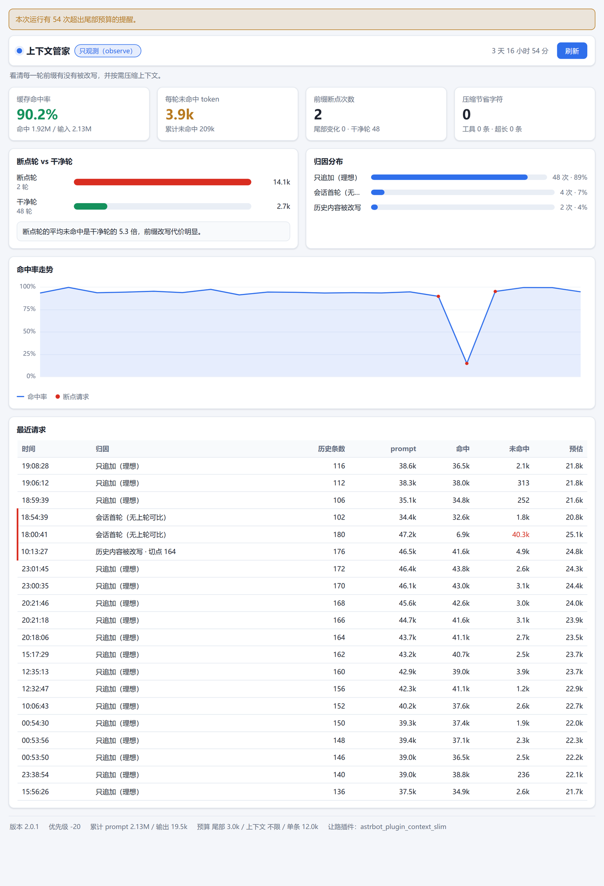

# 上下文管家

AstrBot 插件。看每一次 LLM 请求到底有没有命中前缀缓存；没命中，是被谁改掉的。

拿到请求只看不改，默认一个字节都不动。不注册工具，不联网，只往自己的数据目录写一份 JSONL。

AstrBot 4.16+ · 无第三方依赖 · MIT · v2.0.0 · [English](README.en.md)



> 图里是示例数据，面板文案跟着 WebUI 的语言走。

## 装

```bash
cp -r astrbot_plugin_context_launcher /path/to/astrbot/data/plugins/
docker restart astrbot
```

重启后 WebUI 插件页会多出一个「上下文管家 → 面板」。四个数：命中率、每次请求平均未命中多少 token、断点几次、压缩省了多少字。15 秒自己刷。

不想开页面就直接发 `/上下文`。

## 它看到的是哪一层

AstrBot 里往请求上动手的地方很多：人格、工具、记忆插件、上下文压缩，都挂在 `on_llm_request` 上，优先级从 0 到 100 不等。本插件用的是 `-20`。

负数排最后，所以它拿到的是所有人注入完、马上要发出去的那个 payload。

拿到之后拆三块算指纹：系统提示、工具定义、每一条历史消息，和这个会话的上一轮比：

| 归因 | 意思 |
|---|---|
| `append` | 前面一字不差，只是多了几条。理想情况 |
| `tail` | 只有尾部注入变了 |
| `system` | 系统提示变了，整段重算 |
| `tools` | 工具定义变了，整段重算 |
| `history` | 历史中间有一条被改了 |
| `history_tool` | 同上，改的是工具结果 |
| `history_shrink` | 历史变短，窗口往回退了 |

命中率不估也不猜，只用服务商返回的 `prompt_cache_hit_tokens` 和 `prompt_cache_miss_tokens` 算。服务商不给这两个字段时，页面会直接写「该模型不返回缓存数据」，不会拿个 0% 糊弄过去。

## 我自己那台机器，两天的数据

一台 4C4G 的腾讯云，跑 OneBot + DeepSeek，观察模式，压缩全关。

插件记到的 25 次请求（11-04 02:13 到 11-05 10:14）：

```
23 次前缀完全没变（其中 1 次还是没打中），2 次是会话首轮
前缀没变的那些轮：命中率中位 94.3%，未命中中位 2,259 token
系统提示 12,840 字、45 个工具定义，每轮都在 prompt 里
历史从 146 条涨到 200 条，1.8 万字到 2.4 万字
```

同一台机器，服务商侧统计（`deepseek-flash`）：

```
10-27 ~ 11-02   561 次   命中率 66.0%   每次未命中 8,453 token
11-03 ~ 11-04    57 次   命中率 92.7%   每次未命中 2,578 token
```

11 月初我把工具定义从一百多个砍到 45 个，历史从 106 万字压到 21 万字，插件是这之后才装的，所以它记的是改完之后的样子。中间改的不止一处，这两行数字不该当成某一次改动的功劳。

更有意思的是这条：

```
11-05 10:14   append   hit 9,728   miss 22,293   耗时 123 秒
```

前缀一个字都没变，归因是 `append`，命中率却只有 30%。前后隔了 8 小时，大概率是服务端的缓存过期了。

这说明归因和命中是两个维度：payload 没被谁动过，不等于这次就便宜。只看其中一个都会看错——这也是面板把「断点轮」和「干净轮」分开算的原因。

## 两种压缩，默认都关

先说代价。压缩一定要改历史里的某一条消息，而命中的前提是前缀逐字节相同，所以被改那条之后的所有内容都会重新计费。省下的是「以后每轮少发一点」，付出的是「改的那一轮从断点重算」。面板里的「断点轮 vs 干净轮」就是给这笔账对数的。

本插件的压缩是确定性的：同一条历史消息，每轮算出来是同一个结果，不会今天剪一次明天剪一次。

| 压缩 | 配置 | 什么时候有用 | 代价 |
|---|---|---|---|
| 工具结果裁剪 | `compress_tool_results` | 有插件把整页网页、整个文件、大段日志塞进历史，而且后面几轮不再引用它 | 改动落在历史中部，建议同时把 `compress_tool_keep_recent` 调大 |
| 超长消息裁剪 | `compress_oversize` | 单条消息几万字（长文档、粘贴的日志、OCR 全文），已经不在最近几轮 | 保留首尾、省略中间，原文归档 |

两个都要先把 `mode` 切成 `guard`，`observe` 下不执行任何改写。懒得改配置可以用 `/上下文 压缩 on` 和 `/上下文 压缩 off` 临时开关，运行时生效，不写盘。

## 为什么没有「让 LLM 把老对话总结一下」

因为这件事 AstrBot 核心已经做了。上下文真超长时核心的 overflow 策略会触发，做的就是把老对话变短；插件再实现一遍是重复劳动，还会跟核心的改写互相打架。

更重要的是，LLM 总结出来的文字每轮都不一样，写回历史等于每轮都在改前缀，正好是这插件想消灭的那种开销。裁剪可以做到确定，摘要做不到。

真需要摘要，用核心的 overflow 策略。它跟着上下文窗口的硬限制走，属于保命。

## 配置

和 `_conf_schema.json` 一一对应。多数人只需要看前两行。

| 键 | 类型 | 默认 | 说明 |
|---|---|---|---|
| `enabled` | bool | `true` | 总开关，关掉后钩子直接返回 |
| `mode` | string | `observe` | `observe` 只观测；`guard` 允许按下面阈值压缩 |
| `max_tail_chars` | int | `1800` | 尾部注入超过多少字就告警，`0` 关闭 |
| `max_context_chars` | int | `0` | 历史总字数超过多少告警，`0` 关闭 |
| `compress_tool_results` | bool | `false` | 工具结果裁剪 |
| `compress_tool_keep_recent` | int | `2` | 最近几条工具结果保留原文 |
| `compress_tool_preview_chars` | int | `120` | 裁剪后保留首行多少字 |
| `compress_oversize` | bool | `false` | 超长消息裁剪 |
| `compress_max_msg_chars` | int | `12000` | 超过多少字才动 |
| `compress_keep_head_chars` | int | `4000` | 保留开头多少字 |
| `compress_keep_tail_chars` | int | `1500` | 保留结尾多少字 |
| `compress_keep_recent_msgs` | int | `2` | 最近几条消息不裁 |
| `compress_archive` | bool | `true` | 裁掉的原文归档到插件数据目录 |
| `log_events` | bool | `true` | 每次请求写一行 JSONL |
| `warn_on_break` | bool | `true` | 检测到断点或超预算时打日志 |
| `defer_to` | list | `["astrbot_plugin_context_slim"]` | 让路名单，装了这些就只观测 |

## 命令

| 命令 | 作用 |
|---|---|
| `/上下文` | 汇总：模式、命中率、每次未命中、断点数、压缩节省 |
| `/上下文 诊断` | 最近一次请求的明细 |
| `/上下文 归因` | 各归因的次数和占比 |
| `/上下文 重置` | 清空本次运行的统计 |
| `/上下文 压缩 on\|off` | 一键开关全部压缩 |

## 一些实际情况

- 尾部注入我这边常年在 2,600 到 3,400 字之间，默认 1,800 的告警线基本每轮都响。嫌吵就调到 3,000 以上，或者把 `max_tail_chars` 设成 0 关掉。
- token 数是按字符估的，偏小。实测估 22,755、实际 32,021，差三成。它只适合看量级，别拿去对账。
- 统计从插件启动开始算，重启清零，不补历史。想留档就把 `events.jsonl` 自己存一份。
- 命中率完全取决于服务商折不折给你 usage。不返缓存字段的模型，插件只能统计总量。
- 「请求前缀有没有变」和「账单」不是一回事，中间还隔着服务商的缓存过期、淘汰、路由。
- 只处理纯文本 content。多模态的 part 列表一律跳过，不冒险改写。
- 裁过的消息，模型能看出来被省略过。这是有意的，省略处会写明。
- 可视化视图要 AstrBot 4.16 以上；老版本只能用命令。

## 和别的上下文插件一起装

`defer_to` 里默认就有 `astrbot_plugin_context_slim`。检测到它装了就只观测，并在面板上写明自己在让路，避免两个插件互相改历史。

想让路给别的插件就改这个列表；想谁都不让路，清空它。

至于核心自带的 overflow 压缩，跟本插件重叠的地方是「都会改历史」。本插件的态度是先看清楚：用面板确认命中率低的主因是不是历史太长、是不是核心已经在动手，确认之后开 `guard`，只裁自己该裁的那部分，并且单独记成 `trim`。

## 数据落在哪

只写插件自己的数据目录，别处不写。

- `events.jsonl`：每次请求一行，`log_events=true` 时写，超限轮转。
- `archive/`：被裁掉的原文，按内容哈希命名，同内容只写一次，到上限后只统计不再落盘。

删掉这两个不影响运行。关掉对应开关就不再产生。

## 隐私

插件自己不发起任何外部请求。观测数据和归档原文只在本地，不上报、不遥测。

默认 `observe` 不改 `req` 的任何内容；`guard` 也只改历史消息的文本。任何一步出错都只打一条 debug 日志然后返回零统计，不会把聊天主流程带崩。

另外它不注册 LLM 工具。工具定义每轮都要进 prompt，是常驻开销，一个观测插件不该因为这个变贵。

## License

[MIT](./LICENSE) · Copyright (c) 2026 context_launcher contributors
